# Tutorial Lengkap SKAKMAT (dengan tangkapan layar)

Satu dokumen dari nol sampai paham: cara memakai aplikasi langkah demi langkah dengan screenshot, lalu cara
TOPSIS dan Borda menghitung keputusan dengan angka nyata dari ronde yang sama yang tampil di screenshot.

Dokumen terkait: [PANDUAN_PENGGUNA.md](PANDUAN_PENGGUNA.md) (menyalakan server), [ALGORITMA.md](ALGORITMA.md)
(ringkasan rumus), [PENJELASAN_KODE.md](PENJELASAN_KODE.md) (kode).

---

## Bagian A. Memakai aplikasi

### A1. Masuk atau daftar

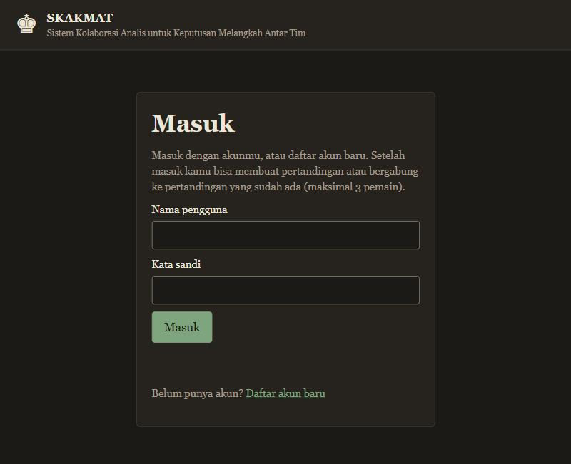

Isi nama pengguna dan kata sandi, atau klik **Daftar akun baru** (nama pengguna 3 sampai 20 karakter huruf
kecil, angka, atau garis bawah; kata sandi minimal 6 karakter). Akun demo: `anggota1`, `anggota2`, `anggota3`.

### A2. Lobi

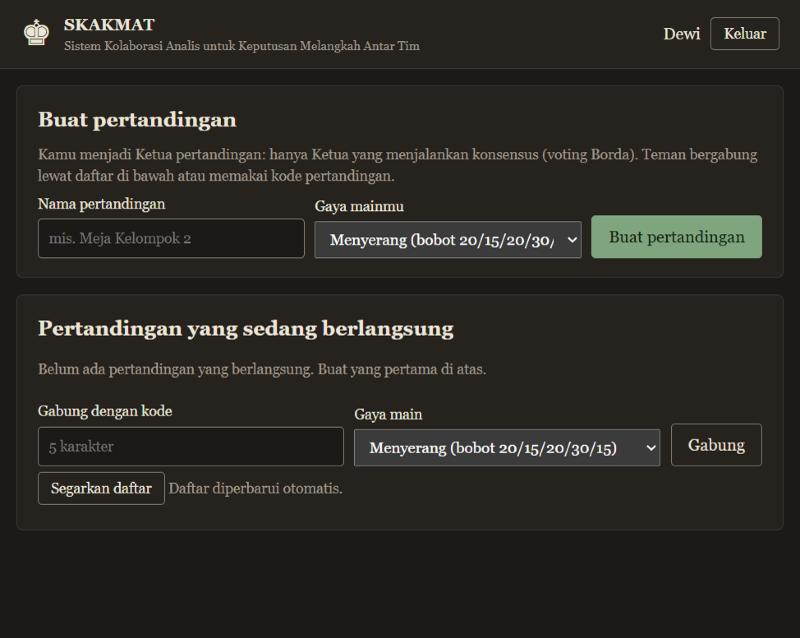

Setelah masuk kamu berada di **lobi**. Dua pilihan: **buat pertandingan** (kamu menjadi **Ketua**) atau
**gabung dengan kode** dari temanmu. Pilih juga **gaya main** (Menyerang, Seimbang, Bertahan).

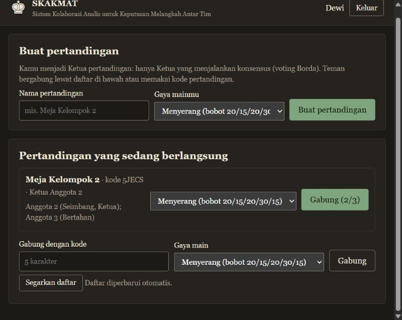

Daftar pertandingan yang berjalan menampilkan nama, kode, jumlah pemain (maksimal 3), Ketua, dan gaya yang
masih kosong. Pilih gaya lalu klik **Gabung**. Satu pemain hanya boleh di satu pertandingan.

### A3. Papan dan status tim

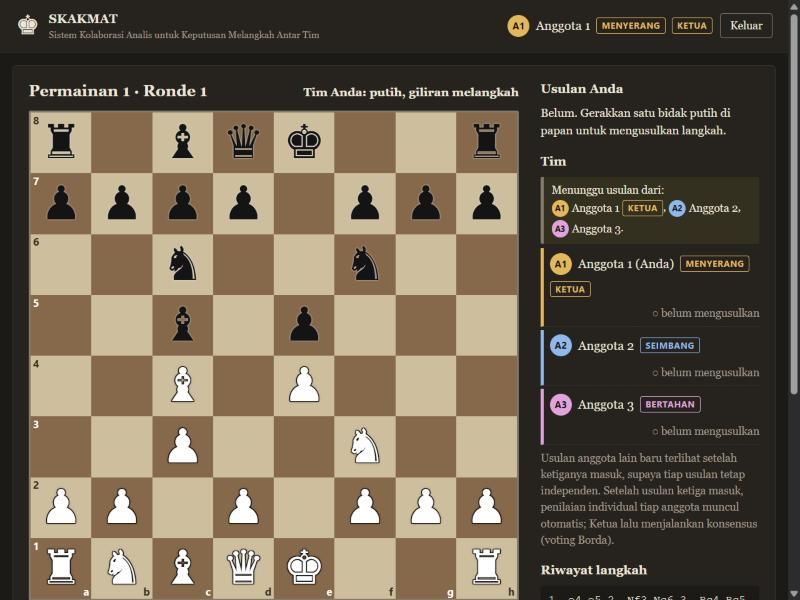

Kamu memegang bidak putih melawan komputer. Panel di kanan memuat kode pertandingan, daftar anggota (dengan
gaya dan penanda **Ketua**), serta riwayat langkah.

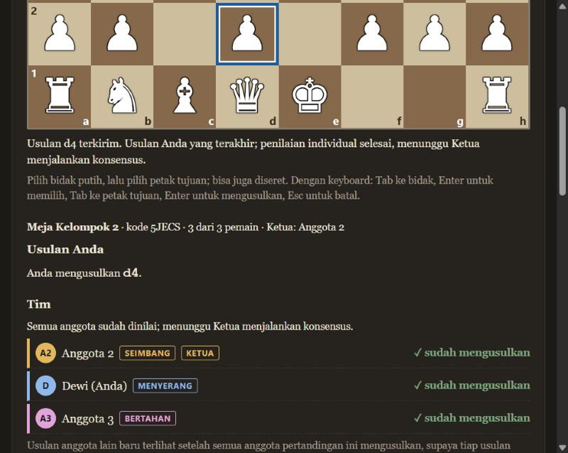

Panel **Tim** menunjukkan siapa yang sudah mengusulkan (centang hijau). Usulan anggota lain disembunyikan
sampai semua mengusulkan, supaya tidak saling memengaruhi.

### A4. Mengusulkan langkah

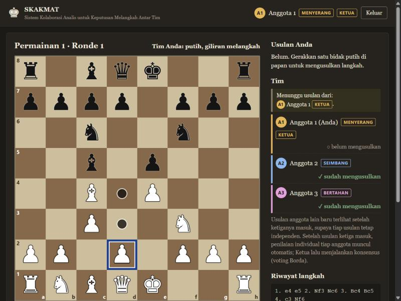

1. Klik bidak putih. Petak tujuan yang sah ditandai.
2. Klik petak tujuan (atau seret bidak). Usulanmu terkirim.
3. Boleh diganti selama belum semua anggota mengusulkan.
4. Keyboard: Tab ke bidak, Enter, Tab ke petak tujuan, Enter, Esc untuk batal.

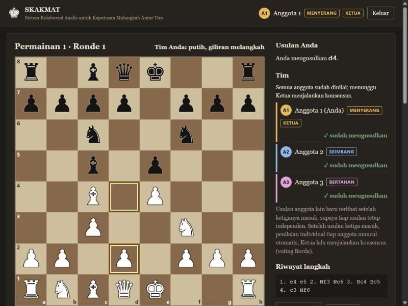

Begitu anggota terakhir mengusulkan, usulan **terkunci** dan penilaian individual dibuat otomatis.

### A5. Penilaian individual

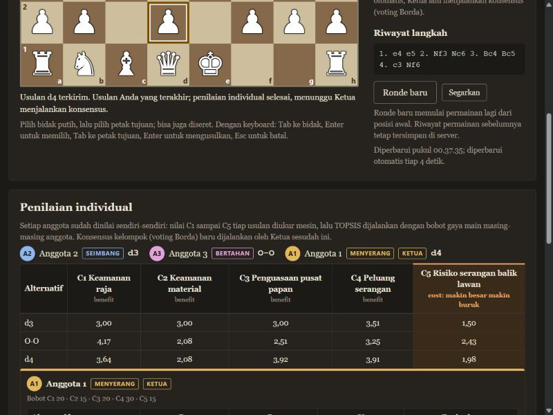

Tabel ini adalah **matriks keputusan**: baris = usulan (d3, O-O, d4), kolom = lima kriteria, nilai 1 sampai 5
yang diukur mesin dari papan. Semua anggota melihat angka yang sama. C5 berwarna khusus karena berjenis
**cost** (makin kecil makin baik).

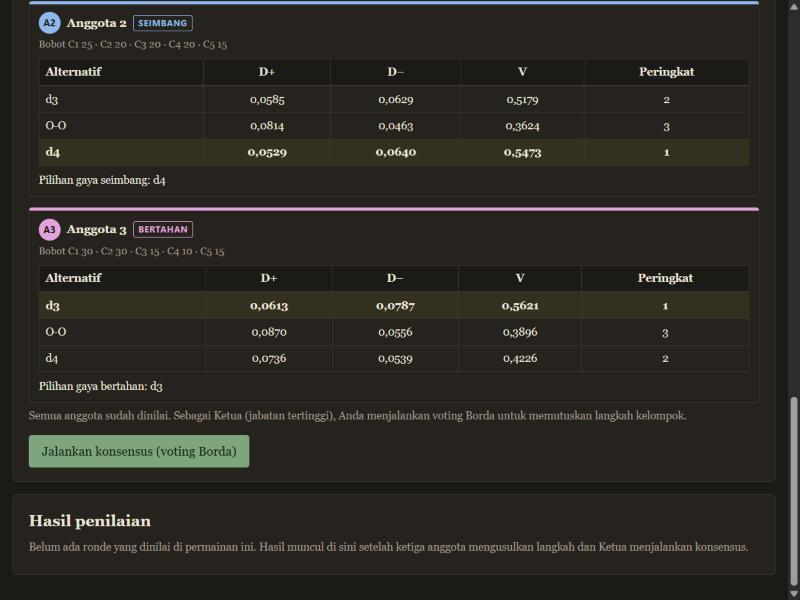

Di bawahnya ada satu tabel TOPSIS per anggota (bobot sesuai gayanya) dengan kolom D+, D−, V, dan peringkat.
Tombol **Jalankan konsensus (voting Borda)** hanya muncul di akun Ketua.

### A6. Anggota biasa menunggu Ketua

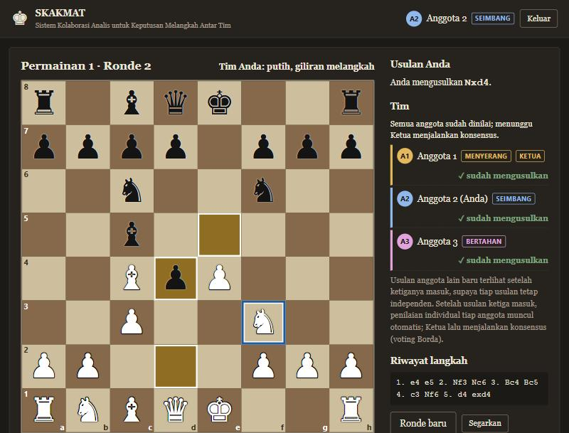

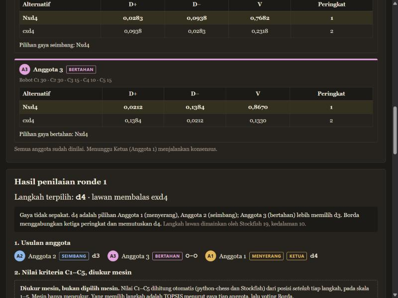

Akun anggota tidak punya tombol konsensus. Server juga menolaknya dengan HTTP 403 bila dipaksa lewat API.

### A7. Hasil konsensus

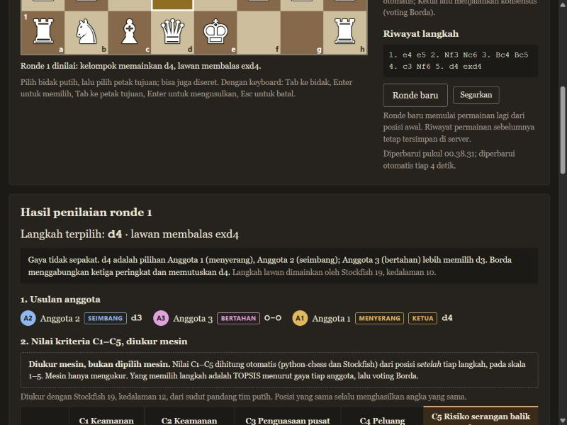

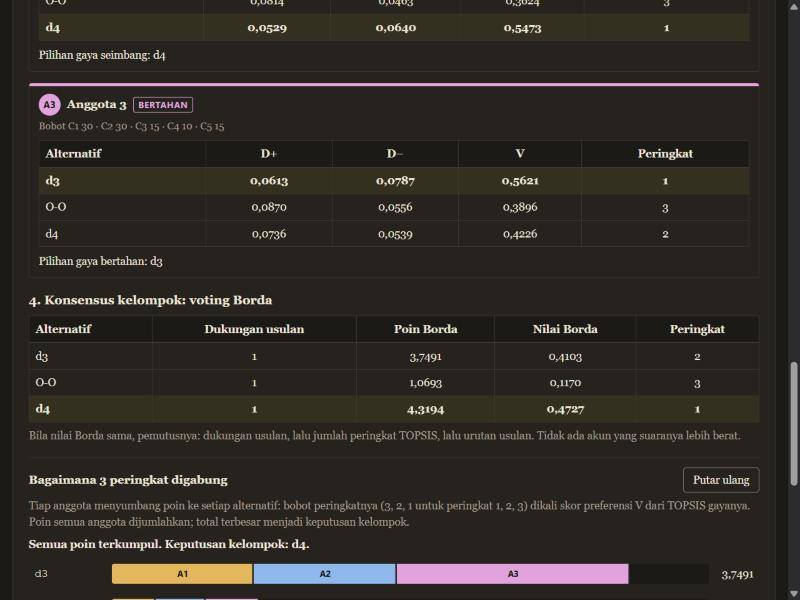

Semua akun melihat tabel Borda (dukungan usulan, poin, nilai, peringkat) dan animasi: batang bertumpuk
menunjukkan poin tiap anggota ditambahkan satu per satu sampai pemenang jelas. Tekan **Putar ulang** untuk
mengulang animasi.

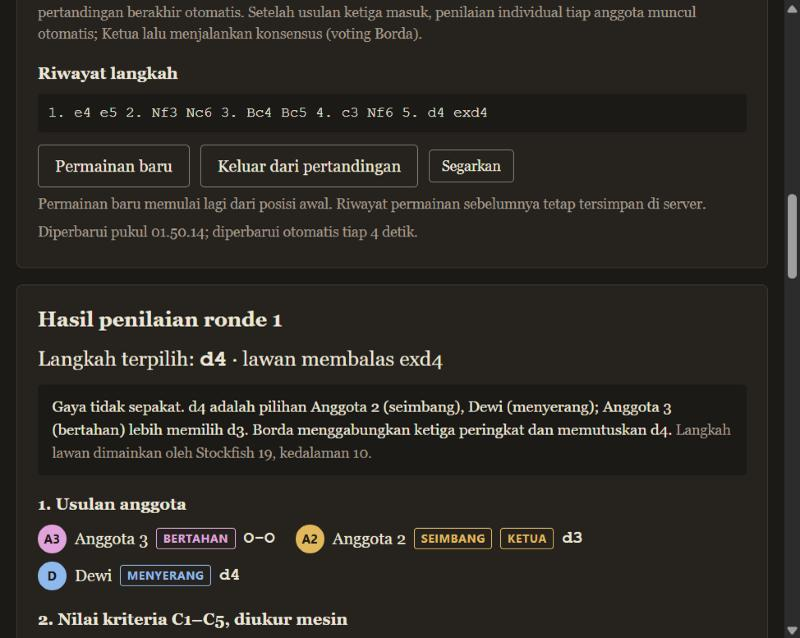

### A8. Ronde berikutnya

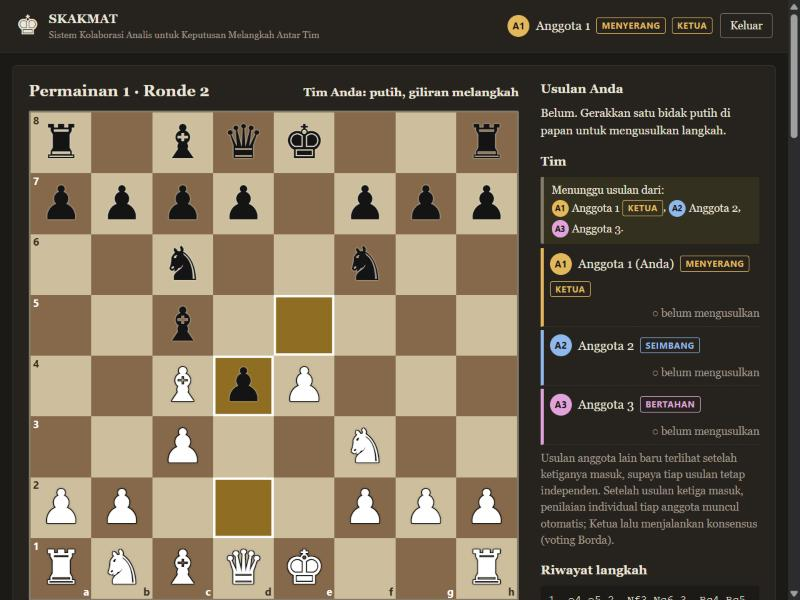

Langkah pemenang (d4) dimainkan, Stockfish membalas (exd4), dan ronde 2 langsung terbuka. Ulangi sampai
permainan selesai (skakmat, pat, atau remis). **Ronde baru** memulai ulang dari posisi awal.

### A9. Keluar dan bergabung lagi


Tombol **Keluar dari pertandingan** mengembalikanmu ke lobi; pertandingan tetap berjalan untuk yang lain.

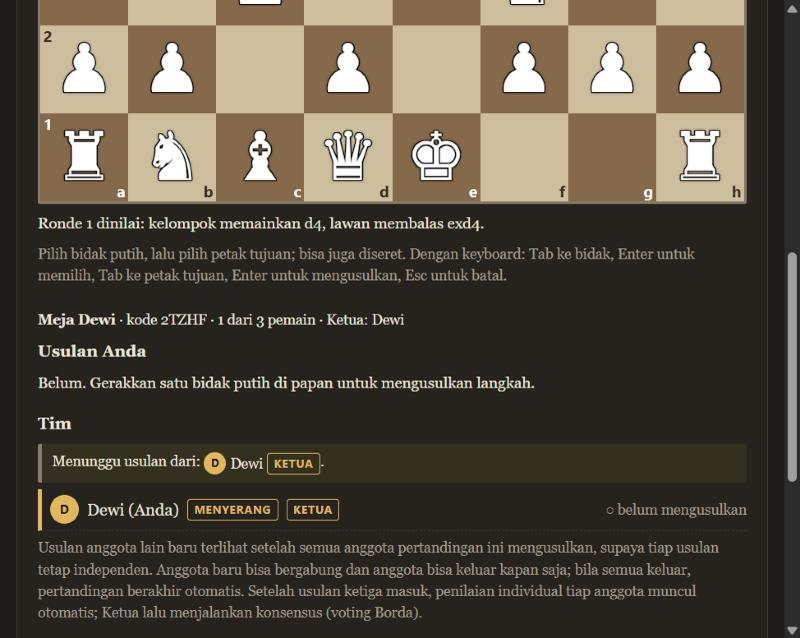

Pemain yang membuat pertandingan otomatis menjadi Ketua. Bila Ketua keluar, anggota yang paling awal bergabung
menjadi Ketua. Bila semua keluar (atau diam 2 menit), pertandingan **berakhir otomatis**.

---

## Bagian B. Cara menghitung: TOPSIS dan Borda dengan angka nyata

Contoh di bawah adalah ronde 1 pada screenshot (posisi Giuoco Piano). Tiga anggota mengusulkan:
**Anggota 2 (Seimbang): d3**, **Anggota 3 (Bertahan): O-O**, **Anggota 1 (Menyerang): d4**.

### B1. Matriks keputusan (diukur mesin)

| Alternatif | C1 Keamanan raja | C2 Keamanan material | C3 Pusat papan | C4 Peluang serangan | C5 Risiko balik (cost) |
|---|---|---|---|---|---|
| d3 | 3,00 | 3,00 | 3,00 | 3,51 | 1,50 |
| O-O | 4,17 | 2,08 | 2,51 | 3,25 | 2,43 |
| d4 | 3,64 | 2,08 | 3,92 | 3,91 | 1,98 |

Angka ini sama dengan tabel di gambar A5. Cara tiap kriteria diukur ada di [ALGORITMA.md](ALGORITMA.md) bagian 3.

### B2. Bobot tiap gaya main

| Gaya | C1 | C2 | C3 | C4 | C5 |
|---|---|---|---|---|---|
| Menyerang | 20 | 15 | 20 | 30 | 15 |
| Seimbang | 25 | 20 | 20 | 20 | 15 |
| Bertahan | 30 | 30 | 15 | 10 | 15 |

Jumlah bobot tiap gaya 100, sehingga bobot pecahan `w = bobot / 100`. Bobot inilah satu-satunya hal yang
membuat peringkat tiap anggota berbeda.

### B3. TOPSIS langkah demi langkah (contoh gaya Seimbang)

**Langkah 1: normalisasi vektor.** Tiap kolom dibagi akar jumlah kuadrat kolomnya:
`r = x / √(Σ x²)`.

Contoh C1: `√(3,00² + 4,17² + 3,64²) = √(9,00 + 17,39 + 13,25) = √39,64 = 6,296`.
Jadi r(d3) = 3,00/6,296 = **0,4765**, r(O-O) = **0,6623**, r(d4) = **0,5782**.

**Langkah 2: kalikan bobot.** `y = w × r`. Contoh C1 gaya Seimbang (w = 0,25):
y(d3) = 0,1191, y(O-O) = 0,1656, y(d4) = 0,1446.

**Langkah 3: solusi ideal positif (A+) dan negatif (A−).** Untuk kriteria *benefit* A+ = nilai terbesar kolom,
A− = terkecil. Untuk *cost* (C5) dibalik: A+ = terkecil, A− = terbesar.

| | C1 | C2 | C3 | C4 | C5 |
|---|---|---|---|---|---|
| A+ | 0,1656 | 0,1428 | 0,1416 | 0,1266 | 0,0647 |
| A− | 0,1191 | 0,0990 | 0,0907 | 0,1052 | 0,1049 |

**Langkah 4: jarak ke ideal.** `D+ = √Σ (y − A+)²`, `D− = √Σ (y − A−)²`.

| Alternatif | D+ | D− |
|---|---|---|
| d3 | 0,0586 | 0,0626 |
| O-O | 0,0811 | 0,0465 |
| d4 | 0,0528 | 0,0638 |

**Langkah 5: skor preferensi.** `V = D− / (D+ + D−)`. Makin dekat ke ideal, makin besar.

- d3: 0,0626 / (0,0586 + 0,0626) = **0,5165**
- O-O: 0,0465 / (0,0811 + 0,0465) = **0,3642**
- d4: 0,0638 / (0,0528 + 0,0638) = **0,5471**

**Langkah 6: peringkat.** d4 (1), d3 (2), O-O (3). Selisih digit terakhir dengan layar muncul karena aplikasi
memakai nilai C tanpa pembulatan.

### B4. Hasil TOPSIS ketiga anggota

Langkah B3 diulang untuk tiap gaya (hanya bobotnya yang berbeda):

| Alternatif | V Menyerang | Peringkat | V Seimbang | Peringkat | V Bertahan | Peringkat |
|---|---|---|---|---|---|---|
| d3 | 0,5134 | 2 | 0,5179 | 2 | 0,5621 | **1** |
| O-O | 0,3172 | 3 | 0,3624 | 3 | 0,3896 | 3 |
| d4 | 0,6108 | **1** | 0,5473 | **1** | 0,4226 | 2 |

Gaya Bertahan memilih d3 karena bobot keamanan raja dan materi (C1, C2) besar; gaya Menyerang memilih d4
karena bobot peluang serangan (C4) besar. Inilah **penilaian individual** (screenshot A5 dan A7).

### B5. Voting Borda

Peringkat 1, 2, 3 diberi bobot Borda 3, 2, 1 (`n − peringkat + 1`). Poin = jumlah (bobot Borda × V) dari ketiga
anggota. Nilai Borda = poin / total poin.

| Alternatif | Perhitungan poin | Poin | Nilai | Peringkat |
|---|---|---|---|---|
| d4 | 3×0,6108 + 3×0,5473 + 2×0,4226 | 4,3194 | 0,4727 | **1** |
| d3 | 2×0,5134 + 2×0,5179 + 3×0,5621 | 3,7491 | 0,4103 | 2 |
| O-O | 1×0,3172 + 1×0,3624 + 1×0,3896 | 1,0693 | 0,1170 | 3 |

Total poin = 9,1378. **d4 menang** walau satu anggota memilih d3, karena dua anggota memberinya peringkat 1
dengan V yang tinggi. Angka ini cocok dengan screenshot A7 (4,3194 / 3,7491 / 1,0693). Setelah itu d4
dimainkan dan Stockfish membalas.

### B6. Bila nilai Borda sama (seri)

Berturut-turut: (1) usulan yang didukung lebih banyak anggota, (2) jumlah peringkat TOPSIS lebih kecil,
(3) usulan yang masuk lebih dulu. Jadi hasilnya selalu pasti, tidak acak.

### B7. Kenapa dua metode, bukan satu

- **TOPSIS saja** hanya memberi satu sudut pandang (satu set bobot).
- Karena tiap anggota punya gaya berbeda, ada **tiga peringkat** yang bisa tidak sepakat.
- **Borda** menggabungkannya memakai *kekuatan* preferensi (nilai V), bukan sekadar menghitung suara.
- Pada 4997 matriks acak, pemenang Borda berbeda dari pemenang TOPSIS satu gaya pada 49 kasus (`test_gdss.py`):
  penggabungan memang bisa mengubah keputusan.

### B8. Giliran lawan

Lawan tidak memakai TOPSIS. Stockfish kedalaman 10 memilih balasan seperti catur biasa. Bila Stockfish tidak
terpasang, dipakai aturan cadangan: ambil skakmat bila ada, kalau tidak tangkapan paling menguntungkan, kalau
tidak langkah pertama menurut urutan UCI.

---

## Bagian C. Bukti bahwa hitungannya benar

| Bukti | Hasil |
|---|---|
| `test_gdss.py` | TOPSIS dicocokkan dengan NumPy pada 200 matriks acak, tiga profil gaya |
| `test_e2e.py` (113) | Borda dari server dihitung ulang di luar server, selisih di bawah 1e-12; semua aturan lobi dan Ketua |
| `test_mesin.py` (48) | C1 sampai C5 deterministik dan arahnya benar (rokade lebih aman, d4 menguasai pusat) |
| Uji browser | seluruh alur pada Bagian A dijalankan dan difoto |

```powershell
.venv\Scripts\python test_gdss.py
.venv\Scripts\python test_mesin.py
.venv\Scripts\python test_e2e.py
```
